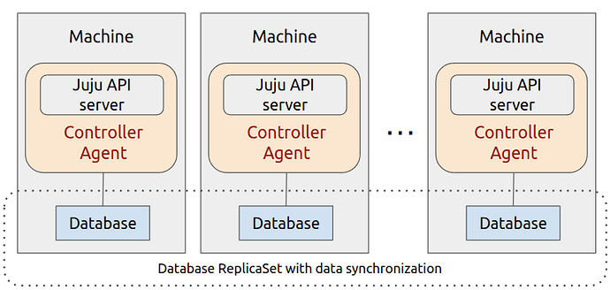

---
myst:
  html_meta:
    description: "High availability in Juju: multi-replica controllers, database replication, and resilient application deployment on machines and Kubernetes."
---

(high-availability)=
# High availability (HA)

```{ibnote}
See also:

- {ref}`make-a-controller-highly-available`
- {ref}`make-an-application-highly-available`
```

In the context of a cloud deployment in general, **high availability (HA)** is the concept of making software resilient to failures by means of running multiple replicas with shared and synchronised software context -- something usually achieved through coordinated {ref}`scaling (out and up) <scaling>`. In Juju, it is supported for controllers on machine clouds and for regular applications on both machine and Kubernetes clouds.




***Controller high availability (machine clouds).** Juju controllers can be made highly-available by enabling more than one machine to each run a separate controller unit with a separate controller agent instance, where each machine effectively becomes an instance of the controller. This set of Juju agents collectively use a Dqlite cluster to achieve data synchronisation amongst them.*

Controller high availability is described on the {ref}`controller <controller>` page: {ref}`how controller nodes are added, removed and listed <controller-nodes>`, {ref}`the Dqlite cluster <dqlite-cluster-of-the-controllers>`, {ref}`the controller charm <controller-charm>`, how {ref}`agents <controller-api-addresses-for-agents>` and {ref}`clients <controller-api-addresses-for-clients>` get the controller addresses, and {ref}`the workers that run on one controller only <controller-single-instance-workers>`. High availability of regular applications is described in {ref}`make-an-application-highly-available`.
